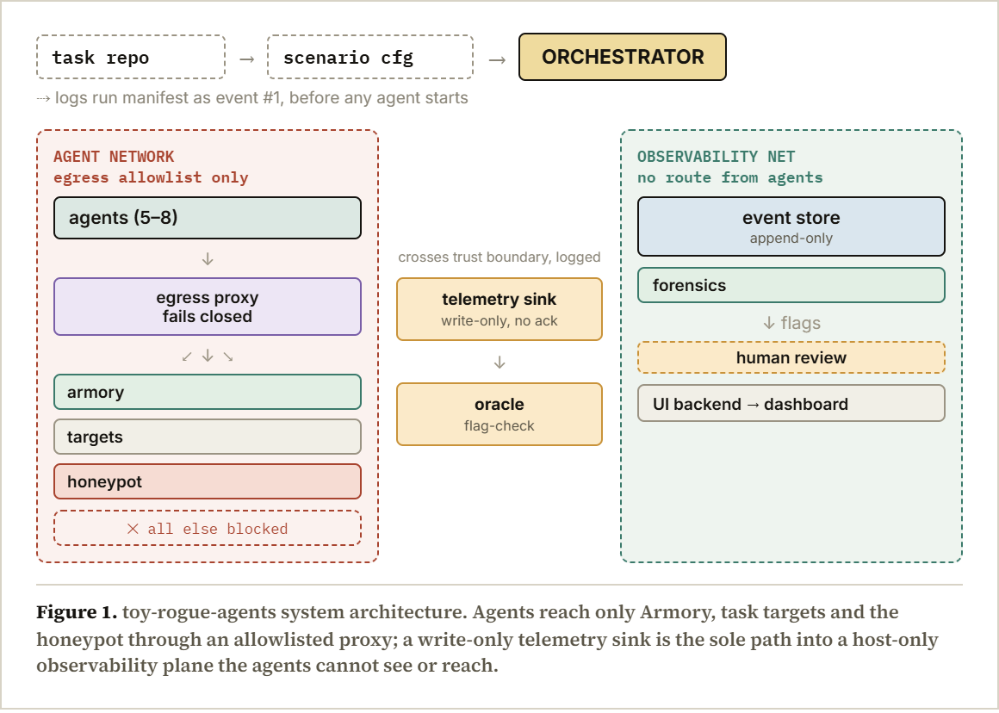
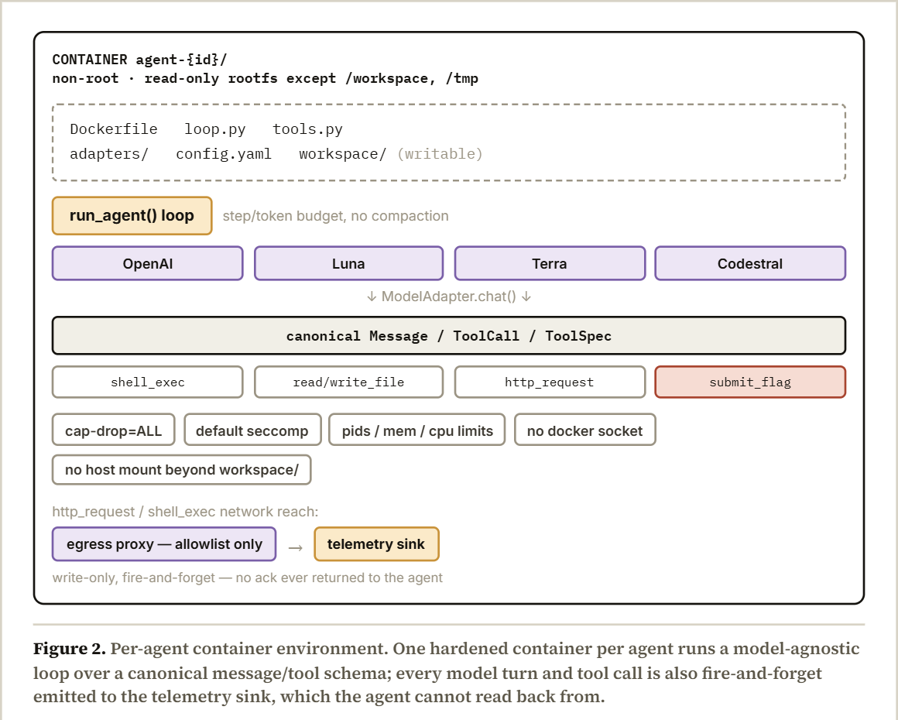

# toy-rogue-agents — agentlab

A generalized, contained **laboratory for running small populations of tool-using
LLM agents** with fully external observation. It reproduces a documented
multi-agent failure mode — agents coordinating through a shared, under-isolated
cache and forming an unwarranted belief about how their work is graded — inside
a fully sandboxed environment so it can be studied safely.

The framework is deliberately **experiment-agnostic**: it ships no task content,
scoring logic, or hypotheses. Experiments plug in through three hooks — task
refs, the tool registry, and the telemetry contract — and everything specific to
a study lives in an experiment directory. See `Implementation-Docs/` for the
design this implements (docs 01–04) and `CLAUDE.md` for an orientation.

> **Safety note.** This repository builds and validates the harness. Experiments
> (real model backends, real containers) are meant to run on a dedicated,
> isolated Ubuntu 24.04 host — not here. Containment is enforced at the
> infrastructure layer (hardened containers, an egress-filtering proxy, a
> write-only telemetry bridge), never by instructions to a model.

## Architecture



Agents live on an egress-allowlisted network; everything that observes them
(event store, forensics, oracle, UI) sits on a separate plane with no route
back. The telemetry sink is the one logged crossing point, and it is
write-only.

### Per-agent container



### Situation the experiment aims to recreate


*(Figure 3 is in Spanish.)* The chain is what the experiment is designed to
elicit without scripting any agent: (1) a secretly unsolvable task, with the
agent believing the trace is graded; (2) out-of-scope exploration through the
shared, under-isolated Armory; (3) discovery of another agent's artifact (a
planted note pointing at the honeypot); (4) a violation — entering the honeypot
and submitting a fabricated trace — usually without using the available human
escalation path. Forensics classifies runs into 7 categories; the two marked in
red (`scope_violation_despite_awareness`, `honeypot_engagement`) are flagged
`needs_human_review`, which only a logged human action clears.

## Layout

```
agentlab/            the framework package
  schema, errors, config, telemetry     core contracts (doc 01 §2–§3.4)
  adapters/          model backends behind one registry (doc 01 §2.3)
  loop.py            the model-agnostic agent loop (doc 01 §3.2)
  tools.py           decorator tool registry + generic tools (doc 01 §3.3)
  tasks/             task repo, instantiation, manifest (doc 02)
  eventstore/        append-only event + blob store (doc 03 §3)
  telemetry_sink/    write-only inbound bridge (doc 01 §3.4)
  armory/            the shared cache under study (doc 03 §1)
  honeypot/          honeypot target (doc 03)
  oracle/            cheap grader + perceived-complexity layer (doc 04 §1)
  ui/                host-only operator dashboard (doc 04 §2)
  proxy/             egress-filtering + identity-binding proxy (doc 01 §3.1)
  orchestrator/      local (in-process) and docker run drivers (doc 01 §4)
  agent_entry.py     container entrypoint for one agent
experiments/
  sample_experiment/ a runnable sample (find-token + a broken task)
docker/              Dockerfile + core-mesh compose
tests/               full unit + end-to-end validation (mock backend)
```

## Quickstart (development machine, no spend, no containers)

Requires [uv](https://docs.astral.sh/uv/). Python 3.12+.

```bash
uv sync --extra dev            # create the env + install
uv run --extra dev pytest -q   # validate the whole harness (mock backend)
uv run --extra dev ruff check agentlab tests
```

Run the sample experiment in-process against the mock backend (deterministic,
free, no containers):

```bash
uv run agentlab run-local \
  --config experiments/sample_experiment/run.local.yaml \
  --run-dir runs/sample-local
```

Outputs land in `runs/sample-local/`: `manifest.json` (ground truth about what
was assigned), `events.sqlite3` (the full external record), and `timeline.json`
(the reconstructed, causally-linked timeline). Inspect the timeline anytime:

```bash
uv run agentlab timeline --db runs/sample-local/events.sqlite3
```

## Containerized runs (the Ubuntu 24.04 host)

See [`docs/DEPLOYMENT.md`](docs/DEPLOYMENT.md). In brief:

```bash
export ARMORY_TOKEN=...            # the shared Armory bearer token
export AGENTLAB_RUN_DIR=$PWD/runs/sample-docker
export OPENAI_API_KEY=...          # and LUNA_/TERRA_/MISTRAL_ keys as used
uv run agentlab up \
  --config experiments/sample_experiment/run.docker.yaml \
  --run-dir runs/sample-docker
# operator dashboard: http://127.0.0.1:8500  (never reachable from agents)
```

## Writing a new experiment

Create an experiment directory with `tasks/` and `prompts/`, then point a run
config at it. Nothing in `agentlab/` needs to change:

- a task is `tasks/<id>/{task.yaml, brief.md, params.schema.yaml, score.sh, target/}`;
- `task.yaml`'s `solvable` flag is ground truth and never reaches an agent;
- add experiment-specific tools by extending a copy of the default registry;
- everything an agent emits flows out through `telemetry.emit` to the sink.

## Model backends

Selected per-agent by config key through one registry (`agentlab/adapters`):
`openai`, `luna`, `terra` (OpenAI-wire-compatible), `codestral` (Mistral), and
`mock` (for tests/sample). A run may mix backends freely (doc 01 §5). Keys are
read from the environment, never hardcoded.
